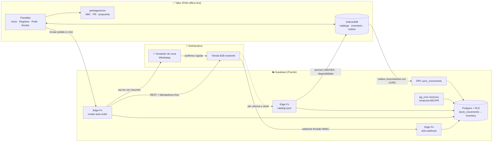
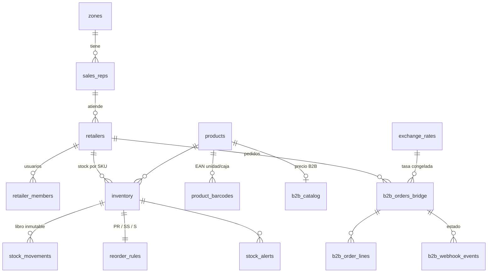

# Stock & Reorden — Guía técnica y de negocio

Sistema de dos capas para una distribuidora autorizada de lubricantes (marca principal Mobil) en Venezuela:

1. **App del taller** (PWA offline-first): entradas/salidas con la cámara, alertas de stock mínimo y propuesta de reposición.
2. **Puente API**: convierte la propuesta del taller en un pedido en la tienda B2B existente y avisa al vendedor de zona.

> Todo lo marcado como **[código]** existe y está probado en este repositorio. Lo marcado como **[decisión pendiente]** necesita información que todavía no tengo (por ejemplo, la plataforma de la tienda B2B).

---

## Índice

- [0. Diagnóstico antes de construir](#0-diagnóstico-antes-de-construir)
- [0.1 Modelo de negocio](#01-modelo-de-negocio)
- [Módulo 1 — Arquitectura y stack](#módulo-1--arquitectura-y-stack)
- [Módulo 2 — Modelo de datos](#módulo-2--modelo-de-datos)
- [Módulo 3 — Algoritmo de inventario](#módulo-3--algoritmo-de-inventario)
- [Módulo 4 — API REST y webhooks](#módulo-4--api-rest-y-webhooks)
- [Módulo 5 — UX/UI del taller](#módulo-5--uxui-del-taller)
- [Módulo 6 — Roadmap de 4 semanas](#módulo-6--roadmap-de-4-semanas)

---

## 0. Diagnóstico antes de construir

Antes del diseño, estos son los puntos en que el planteamiento original tiene huecos, o en que corregirlo cambia el diseño. Todos ya están incorporados en el código.

| # | Supuesto del planteamiento | Lo que realmente pasa | Qué hice en el diseño |
|---|---|---|---|
| 1 | "El taller registrará entradas y salidas" | **Este es el riesgo n.º 1 del proyecto, y no es técnico.** Un mecánico con las manos sucias y una cola de carros no registra cada cuarto de aceite. Si la captura falla, el ABC y el punto de reorden salen mal y la app pierde credibilidad en dos semanas. | Tres cosas: **(a)** el consumo se arranca con el *historial de compras B2B* que la distribuidora ya tiene, así que hay datos útiles desde el primer día sin que el taller registre nada; **(b)** un botón de "Cambio de aceite" que descuenta el combo completo (4 L + filtro) con un solo toque; **(c)** un conteo semanal **solo de los SKU A** (de 5 a 8 productos, menos de 60 s), que corrige cualquier deriva. |
| 2 | ABC con los últimos 30 días | Un taller pequeño vende entre 15 y 40 SKU. En 30 días, una sola flota que cambia aceite de golpe mueve un SKU de C a A. 30 días es una ventana ruidosa. | El código acepta cualquier ventana. Recomiendo **60 días para clasificar** y 30 para mostrar la tendencia. El default se dejó en 30 porque así se pidió. |
| 3 | Disparar cuando `Stock ≤ PR` | Si se compara solo el stock en estante, la app vuelve a pedir **todos los días** hasta que llega el camión: pedidos duplicados y caja inmovilizada. | La alerta compara la **posición**: `en estante + en camino ≤ PR`. El puente actualiza `on_order` en cada pedido. |
| 4 | Demanda promedio = ventas / días | Los días en que el SKU estaba **agotado** registran venta 0, pero sí hubo demanda. Esto subestima justo los SKU A que más se agotan, lo que da un PR más bajo, más quiebres, y el ciclo se repite. | Los días de quiebre se excluyen del cálculo de demanda (demanda censurada). |
| 5 | Reponer hasta el PR | El taller compra "al día": la restricción real es **el efectivo**, no la fórmula. | La propuesta recibe un **presupuesto en USD** y lo reparte: primero saca todos los A de la zona de riesgo, y después llena. Los C solo entran si sobra dinero. |
| 6 | "1-Clic" envía el pedido a la tienda | Un pedido automático sin revisión choca con el límite de crédito, los productos sustitutos y la relación con el vendedor, que es quien vende de verdad en Venezuela. | Hay dos modos: `rep_review` (por defecto: el vendedor confirma por WhatsApp) y `direct`. Para el taller sigue siendo un clic. |
| 7 | Nombre "Mobil Stock & Reorden" | Usar la marca *Mobil* en el nombre de un software requiere autorización expresa del titular o licenciatario de la marca. Ser distribuidor autorizado no la incluye por defecto. | Uso un nombre neutro ("Stock & Reorden"). **[decisión pendiente]** Pedir permiso de co-branding al titular. Si se obtiene, puede volverse un activo de *trade marketing* cofinanciado. |
| 8 | "Ya no se necesita impresora fiscal" | Las flexibilizaciones recientes del SENIAT (facturación digital mediante *imprentas digitales* autorizadas, Providencia SNAT/2024/000102) **cambian el medio, no eliminan la obligación de emitir factura**. | La app **no emite documentos fiscales**: es control interno de inventario. Si en el futuro se quiere facturar desde ella, hay que integrarla con una imprenta digital autorizada. **Validar con un asesor tributario** antes de prometer algo comercialmente. |
| 9 | Inventario en unidades | Los lubricentros venden a **granel por litro** (tambor de 208 L, cuñete de 18,9 L) y también por envase cerrado. | Cantidades `NUMERIC(12,3)`, `base_uom` = unidad o litro, `units_per_case` para redondear el pedido a caja. |
| 10 | Precio en VES "a tasa BCV" | Si cada teléfono consulta el BCV, cada uno muestra una tasa distinta, y la de la factura de la distribuidora puede no coincidir con ninguna. | La tasa la publica **la distribuidora**, y es la misma con la que factura. Cada pedido y cada movimiento **congelan** la tasa usada. |
| 11 | El vendedor ve el inventario del taller | El taller también vende Castrol, PDV y genéricos. Si siente que la distribuidora lo "espía", no adopta la app, y la ve como una herramienta del proveedor, no suya. | Por defecto el vendedor **no ve nada**. El taller activa `share_consumption_data` con consentimiento fechado (RLS). **[decisión pendiente]** Limitar la visibilidad del vendedor solo a los SKU de la distribuidora. |
| 12 | OCR de notas de entrega | El OCR de fotos de notas venezolanas (impresas en matricial, arrugadas, con manchas de aceite) **siempre necesita revisión humana**. | Las notas de la propia distribuidora llevan un **QR con el id del pedido**: un escaneo registra la entrada exacta, sin costo. El OCR (Claude Vision) queda solo para proveedores terceros, en la **fase 2**, y siempre como borrador que el usuario confirma. |

---

## 0.1 Modelo de negocio

**Tesis:** la app no es el producto, es el **canal**. Para la distribuidora el valor está en tres cosas: más participación en las compras del taller (*share of wallet*), pedidos más frecuentes y predecibles, y retención de clientes. Por eso la app se le da **gratis al taller** y la paga la distribuidora como inversión comercial.

| Actor | Qué gana | Cómo se mide |
|---|---|---|
| Taller | No perder ventas por quiebre; no inmovilizar caja en productos C; pedir sin llamar | Quiebres de SKU A por mes; días de inventario |
| Distribuidora | Pedido recurrente "por defecto", menos pedidos a la competencia, demanda visible para planificar compras a Mobil | % de clientes activos que piden por la app; frecuencia de pedido; ticket promedio; *fill rate* |
| Vendedor de zona | Menos tiempo transcribiendo pedidos y más tiempo vendiendo; alertas de clientes en riesgo | Pedidos por visita; clientes atendidos por día |
| Marca (Mobil) | Datos de *sell-out* reales del canal independiente | **[decisión pendiente]** posible cofinanciamiento |

**Costo operativo estimado del MVP (hasta unos 300 talleres):**

| Rubro | Costo mensual aproximado |
|---|---|
| Supabase Pro (BD, Auth, Edge Functions, cron) | USD 25 |
| Hosting de la PWA (Cloudflare Pages) | USD 0 |
| Avisos al vendedor (enlaces `wa.me`) | USD 0 |
| OCR de fase 2 con Claude (1 foto ≈ 2–5 centavos USD) × 200 notas/mes | USD 4–10 |
| Dominio y correo | USD 2 |
| **Total** | **≈ USD 30–40/mes** |

El costo dominante es el **tiempo de onboarding** (que el vendedor instale la app y cargue el inventario inicial con el taller), no la infraestructura. Planifica de 30 a 45 minutos por taller.

**Monetización posterior (cuando haya tracción):** un plan "Pro" para el taller (multi-sucursal, reporte de margen, facturación con imprenta digital), un *dashboard* de sell-out vendido o compartido con la marca, y crédito comercial basado en el historial de rotación (*scoring*).

**Criterio de éxito del piloto (8 semanas, 10 talleres):** al menos 60 % de los talleres con 3 o más pedidos por la app, y una caída medible de quiebres en SKU A. Si a la semana 4 menos del 30 % registra algo, el problema es de adopción, no de tecnología: se rediseña la captura antes de escalar.

---

## Módulo 1 — Arquitectura y stack

### 1.1 Stack recomendado

| Capa | Elección | Por qué | Alternativa descartada |
|---|---|---|---|
| App del taller | **PWA: React 18 + Vite + TypeScript** | Se instala desde un enlace de WhatsApp, sin Play Store. Pesa menos de 1 MB. Funciona en Android de gama baja. Un solo código para el teléfono del taller y el backoffice. | *Flutter*: excelente, pero obliga a publicar en tiendas, exige más trabajo para web, y no aporta cámara ni modo offline que la PWA no tenga. Solo vale la pena si más adelante se necesita Bluetooth o impresoras. |
| Datos offline | **IndexedDB vía Dexie.js** + patrón *outbox* | El teléfono guarda catálogo, inventario y movimientos pendientes. La sincronización es solo de *append*, así que no hay conflictos de merge. | *PowerSync* / *ElectricSQL*: sincronización bidireccional potente, pero con costo y complejidad que el MVP no necesita. |
| Service worker | **Workbox** (vite-plugin-pwa) | Cachea la app y el catálogo; la app abre sin señal. | — |
| Backend | **Supabase**: Postgres 15, Auth, RLS, Edge Functions (Deno), pg_cron | Una sola plataforma. La seguridad por fila (RLS) aísla a cada taller sin escribir middleware. Plan gratis o de USD 25. | Firebase: Firestore no es relacional, y el ABC y los reportes se vuelven dolorosos. |
| Lógica de inventario | **Paquete TypeScript compartido** (`packages/core`) | El **mismo** código calcula en el teléfono (offline) y en el job nocturno. | Un servicio Python aparte: otro deploy y otro lenguaje, sin beneficio. |
| Códigos de barras | **`BarcodeDetector` nativo** (Chrome Android) con *fallback* **zxing-wasm** | Nativo, rápido y gratis. | Apps de terceros como Scandit: licencias caras. |
| Recepción de mercancía | **QR en la nota de entrega de la distribuidora** | Exacto, sin costo y sin IA. Cubre más del 80 % de las entradas. | OCR para todo. |
| OCR (fase 2) | **Claude (visión) con salida JSON Schema** | Lee notas de proveedores terceros, con su formato venezolano (coma decimal, "CJ x12"). | Tesseract: falla con impresión matricial y fotos torcidas. |
| Notificaciones | Web Push + enlace `wa.me` al vendedor | Gratis. Para el vendedor, WhatsApp es el canal real. | WhatsApp Cloud API: es la fase 2, porque tiene costo por conversación. |
| Hosting PWA | Cloudflare Pages | Gratis, con CDN en la región. | — |

### 1.2 Diagrama de flujo de datos



La misma secuencia en ASCII, para quien la lea en una terminal:

```
 TALLER (App)                PUENTE (Supabase)                    TIENDA B2B            VENDEDOR
 ────────────                ─────────────────                    ──────────            ────────
 [Alerta: Stock+Tránsito ≤ PR]
      │ 1 clic "Enviar pedido"
      ├──POST /b2b/create-auto-order──▶ valida JWT + membresía
      │                                 re-cotiza precios (servidor)
      │                                 redondea a caja, congela tasa
      │                                 INSERT orders_bridge + lines
      │                                 on_order += qty
      │                                 ├──POST /orders (Idempotency)──▶ crea pedido
      │                                 │◀───────── order_ref ────────┤
      │◀──201 {order, wa.me}────────────┤
      │                                 └──────────── wa.me resumen ───────────────────▶ revisa
      │                                                                 │◀── ajusta ───┤
      │                                 ◀──webhook order.fulfilled (HMAC)──┤
      │                                 status = fulfilled
 [Llega camión: escanear QR nota]
      ├──RPC receive_b2b_order────────▶ purchase_in por línea
      │                                 on_hand += qty, on_order -= qty
      │◀──── stock actualizado ─────────┤
```

### 1.3 Estrategia offline-first

1. **Lectura:** catálogo, inventario y reglas se guardan en IndexedDB. La app nunca espera a la red para mostrar algo.
2. **Escritura:** cada acción crea un movimiento con `id = crypto.randomUUID()` y `occurred_at` del teléfono, y lo guarda en el *outbox*. El stock local se actualiza al instante (optimista).
3. **Sincronización:** al recuperar señal (eventos `online` y `visibilitychange`, y cada 2 minutos), se envía el outbox **ordenado por `occurred_at`** a `sync_movements`. El servidor responde por id (`ok` o `error`). Los `ok`, incluidos los duplicados ya existentes, salen del outbox.
4. **Sin conflictos:** como los movimientos son eventos inmutables, dos teléfonos del mismo taller nunca "pisan" el stock del otro. El servidor solo suma.
5. **Conteo físico:** el servidor calcula `delta = contado − stock_servidor` al aplicar el conteo. Limitación conocida: una venta offline hecha *antes* del conteo pero sincronizada *después* lo descuadra. La mitigación es ordenar el outbox por `occurred_at` y bloquear el conteo si hay movimientos pendientes en el teléfono (ver 5.4).

---

## Módulo 2 — Modelo de datos

**[código]** `supabase/migrations/0001_core_schema.sql`, `0002_order_lifecycle.sql`. Validado con `supabase/tests/run.sh`, que corre contra Postgres 16 real una prueba de humo con aserciones.

### 2.1 Diagrama entidad-relación



### 2.2 Tablas principales

**`retailers`**: el taller.

| Columna | Tipo | Nota |
|---|---|---|
| `id` | `uuid` PK | |
| `b2b_customer_id` | `text` UNIQUE | ID del cliente en la tienda B2B (vínculo del puente) |
| `rif` | `text` UNIQUE, CHECK `^[JGVEP]-?\d{8}-?\d$` | |
| `business_name`, `trade_name` | `text` | |
| `type` | enum `retailer_type` | lubricentro, taller, repuestos… |
| `zone_id` → `zones`, `sales_rep_id` → `sales_reps` | FK | |
| `default_lead_time_days` | `smallint` (por defecto 2) | días entre pedido y estante |
| `review_period_days` | `smallint` (por defecto 7) | cadencia de compra / visita |
| `weekly_cash_budget_usd` | `numeric(12,2)` | tope de compra para la propuesta |
| `share_consumption_data` + `share_consent_at` | `bool` + `timestamptz` | consentimiento explícito (CHECK) |

**`inventory`**: stock por taller y SKU. `UNIQUE (retailer_id, product_id)`.

| Columna | Tipo | Nota |
|---|---|---|
| `on_hand` | `numeric(12,3)` | **caché** de Σ movimientos (lo mantiene un trigger) |
| `on_order` | `numeric(12,3)` | en tránsito; evita pedir doble |
| `avg_cost_usd` | `numeric(12,4)` | costo promedio ponderado (trigger en `purchase_in`) |
| `sale_price_usd` | `numeric(12,4)` | precio de venta del taller |
| `abc` | enum `A/B/C/N` | lo escribe el job nocturno |

El catálogo vive aparte, en **`products`**: `distributor_sku` (null si la distribuidora no vende ese producto), `brand`, `viscosity`, `base_uom` (unidad o litro), `volume_l`, `units_per_case`. **`product_barcodes`** guarda varios EAN por producto, con `pack_units` (el EAN de una caja vale 12).

**`stock_movements`**: libro **append-only** (un trigger bloquea UPDATE y DELETE).

| Columna | Tipo | Nota |
|---|---|---|
| `id` | `uuid` PK, **generado en el teléfono** | idempotencia de la sincronización |
| `type` | enum: `purchase_in`, `return_in`, `service_out`, `sale_out`, `loss_out`, `adjustment`, `count` | |
| `qty_delta` | `numeric(12,3)` con signo | un CHECK obliga a que el signo sea coherente con el tipo |
| `counted_qty` | `numeric` | solo en `count`; el servidor calcula el delta |
| `unit_cost_usd` / `unit_price_usd` | `numeric(12,4)` | costo en entradas, precio en salidas (ABC por valor) |
| `ves_per_usd` | `numeric(18,6)` | tasa congelada |
| `source` | enum: `manual`, `barcode`, `ocr`, `b2b_delivery_qr`, `count` | calidad del dato |
| `occurred_at` / `received_at` | `timestamptz` | hora del teléfono / hora del servidor |

**`reorder_rules`**: PK = `inventory_id`. Combina parámetros que el dueño puede sobrescribir (`lead_time_days`, `service_level`, `manual_rop`, `manual_safety_stock`, `max_qty`, `mode` auto/manual/off) con los **resultados** que calcula el job: `avg_daily_demand`, `demand_std_daily`, `safety_stock`, `reorder_point`, `order_up_to`, `computed_at`.

**`b2b_orders_bridge`** y **`b2b_order_lines`**:

| Columna | Tipo | Nota |
|---|---|---|
| `idempotency_key` | `text` UNIQUE | lo genera el teléfono |
| `status` | enum: `draft`, `pending_rep`, `submitted`, `accepted`, `rejected`, `partially_fulfilled`, `fulfilled`, `delivered`, `cancelled`, `failed` | |
| `trigger` | enum: `auto_alert`, `manual`, `sales_rep` | para medir cuánto pide la app vs. el vendedor |
| `b2b_order_ref` | `text` UNIQUE | número del pedido en la tienda |
| `ves_per_usd`, `rate_date` | | tasa congelada |
| `subtotal_usd` / `subtotal_ves` | `numeric`; `subtotal_ves` es **GENERATED** | VES siempre derivado, nunca tecleado |
| líneas: `qty_units`, `suggested_units`, `unit_price_usd`, `line_total_usd` (GENERATED), `fulfilled_units`, `reason jsonb` | | `suggested_units` contra `qty_units` mide cuánto confían en el algoritmo |

Tablas de soporte: `exchange_rates`, `b2b_catalog` (espejo de la tienda), `b2b_webhook_events` (idempotencia por `event_id`), `stock_alerts` (índice único parcial: **una sola alerta abierta por SKU y tipo**, para no saturar al usuario).

### 2.3 Decisiones clave

- **El libro es la verdad; `on_hand` es un caché.** Se puede reconstruir siempre con `SELECT sum(qty_delta)`. Una auditoría o un descuadre se explica movimiento por movimiento.
- **Se permite stock negativo** y se genera la alerta `negative_stock`. Bloquear la venta porque el sistema dice 0 cuando el aceite está en el estante es la forma más rápida de que abandonen la app.
- **RLS:** cada taller ve solo lo suyo. El vendedor ve un taller solo si este dio consentimiento. Los pedidos se crean **solo** desde la Edge Function, con `service_role`, para que nadie pueda inventar precios desde el cliente.
- **Funciones RPC:** `sync_movements(jsonb)` (lote del outbox, idempotente, tolera errores por línea), `add_on_order`, `apply_order_status` (cancelado o rechazado libera `on_order`), `receive_b2b_order` (recepción por QR con UUID determinista: escanear dos veces no duplica).

---

## Módulo 3 — Algoritmo de inventario

**[código]** `packages/core/src/` (TypeScript puro, sin dependencias, corre en navegador, Node y Deno). Tests: `packages/core/test/core.test.ts`, con 10 casos que pasan (`npm test`).

### 3.1 Clasificación ABC (Pareto) — `abc.ts`

```ts
export function classifyAbc(series: DailySeries[], opts: AbcOptions = {}): AbcResult[] {
  const { windowDays = 30, aCut = 0.8, bCut = 0.95, basis = 'revenue' } = opts;

  const values = series.map((s) => {
    const src = basis === 'revenue' && s.revenueUsd ? s.revenueUsd : s.qtyOut;
    return { inventoryId: s.inventoryId, value: Math.max(sum(src.slice(-windowDays)), 0) };
  });
  const total = sum(values.map((v) => v.value));
  values.sort((a, b) => b.value - a.value || a.inventoryId.localeCompare(b.inventoryId));

  let cum = 0;
  return values.map(({ inventoryId, value }) => {
    if (value === 0 || total === 0) return { inventoryId, value, share: 0, cumShare: cum / (total || 1), abc: 'N' };
    const before = cum / total;          // acumulado ANTES de este SKU
    cum += value;
    const abc = before < aCut ? 'A' : before < bCut ? 'B' : 'C';
    return { inventoryId, value, share: value / total, cumShare: cum / total, abc };
  });
}
```

Decisiones:
- **Por valor (USD), no por unidades**, como opción por defecto. Un tambor de 208 L de aceite industrial rota poco en unidades, pero pesa mucho en dinero. `basis: 'units'` está disponible.
- **El SKU que cruza el 80 % entra en A.** Con catálogos de 20 SKU, la convención contraria deja la clase A casi vacía.
- **Clase `N`**: SKU sin movimiento en la ventana. Nunca se repone automáticamente, y es candidato a liquidar (inventario muerto).

### 3.2 Punto de reorden dinámico — `reorder.ts`

Fórmulas, con `d` = demanda diaria promedio, `σ` = desviación diaria, `LT` = lead time, `R` = período de revisión y `z` = cuantil del nivel de servicio:

```
SS  = z · σ · √LT                       (stock de seguridad)
PR  = d · LT + SS                       (punto de reorden — la fórmula pedida)
S   = d · (LT + R) + z · σ · √(LT + R)  (nivel "pedir hasta": cuánto comprar)
```

Nivel de servicio por clase: **A = 97 %, B = 93 %, C = 85 %**. Hay más protección donde un quiebre cuesta más.

```ts
export function reorderLevels(p: ReorderParams): ReorderLevels {
  const z = p.serviceLevel > 0 ? normInv(p.serviceLevel) : 0;
  const lt = Math.max(0, p.leadTimeDays);
  const r = Math.max(1, p.reviewPeriodDays);

  const safetyStock = p.manualSafetyStock ?? z * p.stdDaily * Math.sqrt(lt);
  let reorderPoint = p.manualRop ?? p.avgDaily * lt + safetyStock;
  if (p.avgDaily > 0) reorderPoint = Math.max(reorderPoint, 1);   // piso: no alertar recién en 0

  let orderUpTo = p.avgDaily * (lt + r) + z * p.stdDaily * Math.sqrt(lt + r);
  orderUpTo = Math.max(orderUpTo, reorderPoint + (p.unitsPerCase ?? 1));
  if (p.maxQty != null) orderUpTo = Math.min(orderUpTo, p.maxQty);
  return { safetyStock, reorderPoint, orderUpTo };
}
```

La demanda (`demandStats`) **excluye los días en que el SKU estuvo agotado**: ver el punto 4 del diagnóstico.

**Ejemplo numérico** (Mobil Super 2000 10W-30, 1 qt):

| Dato | Valor |
|---|---|
| Demanda diaria `d` | 6 qt/día (σ = 2) |
| Lead time | 2 días |
| Nivel de servicio | 95 % (fijado por el dueño; el default de A es 97 %) → z = 1,645 |
| SS = 1,645 × 2 × √2 | **4,65 qt** |
| PR = 6 × 2 + 4,65 | **16,65 qt** → alerta cuando *en estante + en camino* ≤ 16 |
| S (R = 7 días) | 6 × 9 + 1,645 × 2 × 3 = **63,9 qt** |
| Con 10 en estante: pedir 63,9 − 10 = 53,9 → redondeado a cajas de 12 | **5 cajas (60 qt)** |

### 3.3 Disparador de alerta — `alerts.ts`

```ts
export function evaluateAlert(s: SkuState, leadTimeDays: number): StockAlert {
  const position = s.onHand + s.onOrder;                       // ¡incluye lo que viene en camino!
  const daysOfCover = s.avgDailyDemand > 0 ? s.onHand / s.avgDailyDemand : Infinity;

  let level: AlertLevel = 'ok';
  if (s.onHand <= 0 && s.avgDailyDemand > 0) level = 'stockout';
  else if (position <= s.reorderPoint && daysOfCover < leadTimeDays) level = 'critical';
  else if (position <= s.reorderPoint) level = 'reorder';
  ...
}
```

Hay cuatro niveles para el semáforo de la pantalla de inicio: **verde** (ok), **amarillo** (toca pedir), **naranja** (no alcanza hasta que llegue el pedido) y **rojo** (agotado).

### 3.4 Propuesta "1-Clic" con presupuesto — `proposal.ts`

```
candidatos = SKU con posición ≤ PR, ordenados por (clase A→C, menos días de cobertura primero)
Pasada 1 (CUBRIR): a cada candidato, las cajas mínimas para quedar > PR, si alcanza el dinero
Pasada 2 (LLENAR): con el resto, completar hasta S en el mismo orden
Salida: líneas (cajas, USD, razón legible) + "diferidos" (lo que no alcanzó → se muestra al dueño)
```

Así, con USD 120 en caja, el sistema compra primero la caja de aceite A que se va a agotar mañana, y no el aditivo C que puede esperar. El test `propuesta con presupuesto…` lo verifica.

### 3.5 Cuándo corre cada cálculo

| Dónde | Qué | Cuándo |
|---|---|---|
| Teléfono | `evaluateAlert` y `buildProposal` con los PR ya calculados | En cada movimiento (offline) |
| Servidor (pg_cron, 2:00 a.m.) | `demandStats` → `classifyAbc` → `reorderLevels` → escribe `inventory.abc` y `reorder_rules` | Diario |
| Arranque en frío | Si un SKU tiene menos de 14 días de historia propia, se usa su **historial de compras B2B** como estimador de consumo (*sell-in*) | Al vincular un taller |

Esqueleto del job nocturno (Edge Function `recompute-reorder`, invocada por pg_cron con `net.http_post`):

```ts
import { classifyAbc, demandStats, reorderLevels, DEFAULT_SERVICE_LEVEL } from '../../../packages/core/src/index.ts';

for (const retailer of retailers) {
  const series = await loadSeries(retailer.id);            // v_daily_demand + días con on_hand ≤ 0
  const abc = new Map(classifyAbc(series, { windowDays: 60 }).map((r) => [r.inventoryId, r.abc]));
  const rows = series.map((s) => {
    const cls = abc.get(s.inventoryId)!;
    const st = demandStats(s, 60);
    const rule = rules.get(s.inventoryId);
    const lv = reorderLevels({
      avgDaily: st.avgDaily, stdDaily: st.stdDaily,
      leadTimeDays: rule?.lead_time_days ?? retailer.default_lead_time_days,
      reviewPeriodDays: retailer.review_period_days,
      serviceLevel: rule?.service_level ?? DEFAULT_SERVICE_LEVEL[cls],
      unitsPerCase: unitsPerCase.get(s.inventoryId), manualRop: rule?.manual_rop ?? undefined,
    });
    return { inventory_id: s.inventoryId, abc: cls, ...st, ...lv };
  });
  await upsertRulesAndAbc(rows);                           // un UPSERT por taller
}
```

---

## Módulo 4 — API REST y webhooks

**[código]** Especificación completa en `api/openapi.yaml` (validada con Redocly). Implementación en `supabase/functions/*`.

Un dominio propio (`api.<distribuidora>.com`) reescribe `/api/v1/*` → `/functions/v1/*` de Supabase. Así se puede cambiar de proveedor sin tocar la app.

### 4.1 `POST /api/v1/auth/token`

Hay tres `grant_type`:

| Flujo | Quién lo usa | Resultado |
|---|---|---|
| `activation_code` | Teléfono del taller, en el onboarding | Sesión Supabase (access 1 h + refresh de larga duración) |
| `client_credentials` | Tienda B2B / ERP (servidor a servidor) | JWT de 15 min con scopes |
| `refresh_token` | Renovación | Nuevo access token |

```http
POST /api/v1/auth/token
Content-Type: application/json

{ "grant_type": "activation_code", "code": "K7P2-M9QX", "pin": "4821",
  "device_id": "and-3f9c1b", "device_name": "Samsung A14 mostrador" }
```

```json
{ "access_token": "eyJhbGciOi...", "token_type": "bearer", "expires_in": 3600,
  "refresh_token": "v1.Mr9....",
  "retailer": { "id": "1b0c6c2e-...", "trade_name": "Lubricentro El Pistón", "role": "owner" } }
```

**Por qué un código de activación y no un OTP por SMS:** los SMS a operadoras venezolanas llegan tarde o no llegan, y cuestan. El vendedor crea el taller en el backoffice y le muestra un QR. El taller lo escanea, define un PIN y queda logueado por meses. Límites: 5 intentos por código cada 15 minutos; el código vence a las 72 h y es de un solo uso.

Implementación sugerida: la función valida el código (hash bcrypt en una tabla `activation_codes`), crea o recupera el usuario con `auth.admin.createUser`, genera un enlace mágico con `auth.admin.generateLink({ type: 'magiclink' })` y lo intercambia por la sesión. El PIN se guarda hasheado y se usa **localmente** para cambiar entre el dueño y el mostrador.

### 4.2 `GET /api/v1/b2b/catalog-sync?since=<cursor>`

- La respuesta incluye la **tasa del día** y cada ítem con `price_usd`, `price_ves`, `available`, `stock_band` (`high`, `low` u `out`: nunca el stock exacto de la distribuidora), `units_per_case` y los códigos de barra.
- Es **incremental** (`since` / `next_since`) y soporta **ETag** (`304`), para ahorrar datos móviles.

```json
{
  "rate": { "date": "2026-10-22", "ves_per_usd": 215.5, "source": "BCV" },
  "full": false,
  "next_since": "2026-10-22T11:04:10.512Z",
  "items": [{
    "product_id": "8a1e2f4c-...", "sku": "MOB-S2000-1030-QT", "brand": "Mobil",
    "name": "Mobil Super 2000 10W-30 1 qt", "viscosity": "10W-30", "base_uom": "unit",
    "volume_l": 0.946, "units_per_case": 12,
    "barcodes": [{ "barcode": "0071924XXXXXX", "pack_units": 1 }],
    "price_usd": 5.10, "price_ves": 1099.05, "available": true, "stock_band": "high",
    "min_order_units": 12, "updated_at": "2026-10-22T11:04:10.512Z"
  }]
}
```

### 4.3 `POST /api/v1/b2b/create-auto-order`

```json
{
  "retailer_id": "1b0c6c2e-6c55-4f0e-9a2b-0d3a3b1f6a10",
  "idempotency_key": "ord-and-3f9c1b-20261022-0007",
  "trigger": "auto_alert",
  "payment_currency": "USD",
  "notes": "Entregar antes de las 11am",
  "lines": [
    { "product_id": "8a1e2f4c-...", "qty_units": 24, "suggested_units": 30,
      "reason": { "abc": "A", "on_hand": 7, "on_order": 0, "reorder_point": 16.6, "order_up_to": 40 } }
  ]
}
```

Respuesta `201` (o `200` con `"replayed": true` si se repite la `idempotency_key`):

```json
{
  "order": { "id": "5e0f...", "status": "pending_rep", "b2b_order_ref": null,
             "rate_date": "2026-10-22", "ves_per_usd": 215.5,
             "subtotal_usd": 122.40, "subtotal_ves": 26377.20, "lines": [ ... ] },
  "unavailable": [],
  "rep_whatsapp_url": "https://wa.me/58412XXXXXXX?text=Pedido%20app..."
}
```

Lo que hace el servidor, en orden ([`create-auto-order/index.ts`](../supabase/functions/create-auto-order/index.ts)):

1. Valida el JWT y que el usuario sea miembro del taller.
2. Revisa la idempotencia: si la key ya existe, devuelve el pedido original.
3. **Re-cotiza** con `b2b_catalog` (los precios del cliente se ignoran), descarta lo no disponible y redondea a caja.
4. Congela la tasa e inserta la cabecera y las líneas.
5. Llama a `add_on_order` (el stock en tránsito apaga la alerta).
6. Según el modo: `rep_review` → `pending_rep`; `direct` → llama a la tienda con el **adaptador**. Si falla, el estado queda en `failed` con `last_error`, y el pedido es reintentable.
7. Devuelve el enlace `wa.me` con el resumen para el vendedor.

Errores: `422 validation_error`, `403 forbidden`, `409 not_linked | nothing_available | duplicate`, `503 no_rate`.

### 4.4 Webhooks desde la tienda — `POST /api/v1/b2b/webhooks`

- Eventos: `order.accepted`, `order.rejected`, `order.partially_fulfilled`, `order.fulfilled`, `order.cancelled`, `catalog.updated`.
- Firma: `X-Signature: t=<unix>,v1=<HMAC-SHA256(secret, t + "." + body)>`, ventana de 5 minutos y comparación en tiempo constante.
- Idempotencia por `event_id` (`b2b_webhook_events`). Si el procesamiento falla se responde 500, y la tienda reintenta.
- `cancelled` o `rejected` liberan `on_order`. `fulfilled` registra `fulfilled_units`, que es lo que entra al stock cuando el taller escanea el QR.

### 4.5 Integración con la tienda existente **[decisión pendiente]**

No conozco la plataforma de la tienda B2B. El puente habla con la interfaz `B2BStoreAdapter` (`_shared/b2b-adapter.ts`):

| Si la tienda es… | Crear pedido | Recibir estado |
|---|---|---|
| WooCommerce | `POST /wp-json/wc/v3/orders` (mapear SKU → `product_id`; `meta_data.external_ref`) | Webhooks nativos `order.updated` → traducir |
| Shopify (B2B) | Admin GraphQL `draftOrderCreate` + `draftOrderComplete` | Webhook `orders/updated` |
| Odoo | JSON-RPC `sale.order.create` | Acción automatizada → webhook |
| Desarrollo propio | Implementar `/orders` y `/catalog` como en `RestStoreAdapter` | Emitir los webhooks de 4.4 |

Si la tienda **no tiene API**, el modo `rep_review` funciona igual: el vendedor recibe el pedido por WhatsApp y lo carga a mano. El taller no nota la diferencia, y la integración se puede hacer después.

---

## Módulo 5 — UX/UI del taller

### 5.1 Principios "cero fricción" para un mostrador de taller

1. **Máximo 3 toques** para las acciones diarias (tabla 5.3).
2. **Botones de 56 px o más**, alto contraste y tipografía de 18 px o más. Se usa con sol, con guantes o con dedos sucios, y en pantallas de 5–6".
3. **Sin teclado cuando se pueda:** escáner, botones `+1 / +4 / +12` y combos predefinidos.
4. **Nunca bloquear:** sin señal, la app funciona igual. Un indicador discreto (☁️ 3 pendientes) es todo lo que el usuario ve de la sincronización.
5. **Lenguaje del taller:** "Te quedan 4 días", no "Cobertura: 4,2 d". "Toca pedir", no "Punto de reorden alcanzado".
6. **Precios en las dos monedas**, el USD grande y el Bs. pequeño, con la fecha de la tasa.
7. **Deshacer en 5 segundos** en vez de diálogos de "¿Está seguro?".

### 5.2 Pantallas

```
┌─────────── 1. INICIO ───────────┐  ┌────── 2. REGISTRAR (cámara) ─────┐
│ Lubricentro El Pistón   ☁️ ✓    │  │ ┌──────────────────────────────┐ │
│ Tasa 22/10: 215,50 Bs/$         │  │ │                              │ │
│                                 │  │ │      [ visor de cámara ]     │ │
│ 🔴 1 agotado   🟠 2  🟡 3        │  │ │      ─ ─ ─ ─ ─ ─ ─ ─ ─       │ │
│ ┌─────────────────────────────┐ │  │ └──────────────────────────────┘ │
│ │ 🔴 Mobil 1 5W-30 qt   AGOTADO│ │  │ ✔ Mobil Super 2000 10W-30 qt    │
│ │ 🟠 Super 2000 20W-50  2 días │ │  │   Stock: 14                      │
│ │ 🟡 Delvac 15W-40 gal  4 días │ │  │                                  │
│ └─────────────────────────────┘ │  │  [ −1 ]   [  4  ]   [ +1 ]       │
│ ┌─────────────────────────────┐ │  │  [+4]   [+12 caja]               │
│ │  🛒 PEDIR 6 PRODUCTOS · $214 │ │  │                                  │
│ └─────────────────────────────┘ │  │ [ SALIDA ⬇ ]     [ ENTRADA ⬆ ]   │
│ [🛢 Cambio aceite][📷 Escanear] │  └──────────────────────────────────┘
│ [📦 Recibir]     [🔢 Contar A]  │
└─────────────────────────────────┘

┌──────── 3. CAMBIO DE ACEITE ────┐  ┌─────────── 4. PEDIDO ────────────┐
│ ¿Qué aceite?                    │  │ Propuesta para hoy · Caja: $250  │
│ [Super 2000 10W-30] [20W-50]    │  │ ☑ Mobil 1 5W-30 qt  2 cj  $122  │
│ [Delvac 15W-40]     [otro…]     │  │ ☑ Super 2000 20W-50 1 cj  $ 58  │
│                                 │  │ ☑ Filtro PH8A       1 cj  $ 34  │
│ Litros:  [3,5] [4] [4,5] [5]    │  │   (toca para cambiar cajas)     │
│ ☑ Filtro de aceite (−1)         │  │ ─────────────────────────────── │
│                                 │  │ Total  $214,00 · Bs 46.117,00   │
│ [  ✔ LISTO  ]                   │  │ Quedan para después: Aditivo ×1 │
└─────────────────────────────────┘  │ [ 📤 ENVIAR A MI VENDEDOR ]      │
                                     └──────────────────────────────────┘
┌──────────── 5. RECIBIR ─────────┐
│ Escanea el QR de la nota        │
│ de entrega                      │
│ [ visor ]                       │
│ ✔ Pedido PED-104233: 3 productos│
│   +24 Mobil 1 · +12 Super 2000  │
│ [ ✔ CONFIRMAR ENTRADA ]         │
│ ¿Otro proveedor? → 📷 Foto (OCR)│
└─────────────────────────────────┘
```

### 5.3 Conteo de toques por tarea

| Tarea diaria | Recorrido | Toques |
|---|---|---|
| Registrar un cambio de aceite | Inicio → *Cambio aceite* → elegir aceite (4 L y filtro vienen por defecto) → *Listo* | **3** |
| Vender un envase por escáner | *Escanear* → (lee el código) → *Salida* | **2** |
| Enviar el pedido sugerido | *Pedir 6 productos* → *Enviar a mi vendedor* | **2** |
| Recibir mercancía de la distribuidora | *Recibir* → (escanea el QR) → *Confirmar* | **2** |
| Conteo semanal de los A | *Contar A* → corregir solo lo que difiera → *Guardar* | 2 + correcciones |

### 5.4 Módulo de escaneo

**Códigos de barras:** se usa `BarcodeDetector` nativo cuando existe (Chrome Android 83+); si no, **zxing-wasm**. Al leer un código se busca primero en `product_barcodes`, que es local y offline. Si no aparece, se ofrece "Crear producto" con el nombre y la marca, y el código queda asociado para la próxima vez.

```ts
// app/src/scan/useBarcode.ts — lectura continua con deduplicación
export async function startScanner(video: HTMLVideoElement, onCode: (code: string) => void) {
  const stream = await navigator.mediaDevices.getUserMedia({
    video: { facingMode: 'environment', width: { ideal: 1280 } }, audio: false,
  });
  video.srcObject = stream;
  await video.play();

  const detect = 'BarcodeDetector' in window
    ? await nativeDetector()
    : await zxingDetector();               // import dinámico: solo se descarga si hace falta

  let last = '', lastAt = 0, stopped = false;
  const loop = async () => {
    if (stopped) return;
    const code = await detect(video).catch(() => null);
    const now = performance.now();
    if (code && (code !== last || now - lastAt > 2000)) {   // evita leer 10 veces el mismo envase
      last = code; lastAt = now;
      navigator.vibrate?.(60);                              // feedback háptico: no hace falta mirar
      onCode(code);
    }
    setTimeout(loop, 120);                                  // ~8 fps: suficiente y no calienta el teléfono
  };
  loop();
  return () => { stopped = true; stream.getTracks().forEach((t) => t.stop()); };
}

async function nativeDetector() {
  const d = new (window as any).BarcodeDetector({ formats: ['ean_13', 'ean_8', 'upc_a', 'code_128', 'qr_code'] });
  return async (v: HTMLVideoElement) => (await d.detect(v))[0]?.rawValue ?? null;
}

async function zxingDetector() {
  const { readBarcodes } = await import('zxing-wasm/reader');
  const canvas = new OffscreenCanvas(640, 480);
  const ctx = canvas.getContext('2d')!;
  return async (v: HTMLVideoElement) => {
    ctx.drawImage(v, 0, 0, 640, 480);
    const r = await readBarcodes(ctx.getImageData(0, 0, 640, 480), { formats: ['EAN-13', 'EAN-8', 'UPC-A', 'Code128', 'QRCode'] });
    return r[0]?.text ?? null;
  };
}
```

**QR de la nota de entrega:** la distribuidora imprime en cada nota un QR con `https://app.<dominio>/r/<order_id>`. Si lo escanea la app, llama a `receive_b2b_order(order_id)`. Si se escanea con la cámara normal del teléfono, abre la PWA en la pantalla *Recibir*.

**OCR de notas de terceros (fase 2):** el usuario toma la foto, el teléfono la comprime a ~1600 px en JPEG y la envía a `/ocr/delivery-note` ([`ocr-delivery-note/index.ts`](../supabase/functions/ocr-delivery-note/index.ts)). Claude devuelve JSON validado contra un esquema (proveedor, número de nota, líneas con código, descripción, cantidad, precio y confianza). La app muestra el **borrador para confirmar** con las líneas de baja confianza resaltadas. Nada entra al inventario sin ese toque de confirmación.

**Outbox offline (Dexie):**

```ts
// app/src/offline/db.ts
import Dexie, { type Table } from 'dexie';

export interface PendingMovement {
  id: string; retailer_id: string; inventory_id: string; type: string;
  qty_delta: number; counted_qty?: number; unit_price_usd?: number;
  occurred_at: string; source: string; device_id: string; attempts: number;
}

class LocalDb extends Dexie {
  outbox!: Table<PendingMovement, string>;
  inventory!: Table<{ id: string; product_id: string; on_hand: number; on_order: number }, string>;
  constructor() {
    super('stock-reorden');
    this.version(1).stores({ outbox: 'id, occurred_at', inventory: 'id, product_id' });
  }
}
export const db = new LocalDb();

// Registrar = escribir local (instantáneo) + encolar
export async function record(m: Omit<PendingMovement, 'id' | 'occurred_at' | 'attempts'>) {
  const mov = { ...m, id: crypto.randomUUID(), occurred_at: new Date().toISOString(), attempts: 0 };
  await db.transaction('rw', db.outbox, db.inventory, async () => {
    await db.outbox.add(mov);
    await db.inventory.where('id').equals(m.inventory_id).modify((i) => { i.on_hand += m.qty_delta; });
  });
  void flush();
}

// Sincronizar: lotes de 50 en orden causal; idempotente del lado servidor
export async function flush() {
  if (!navigator.onLine) return;
  const batch = await db.outbox.orderBy('occurred_at').limit(50).toArray();
  if (!batch.length) return;
  const { data, error } = await supabase.rpc('sync_movements', { p_movements: batch });
  if (error) return;                                       // reintenta en el próximo ciclo
  const ok = data.filter((r: any) => r.status === 'ok').map((r: any) => r.id);
  await db.outbox.bulkDelete(ok);
  // Los rechazados quedan visibles en "Pendientes" para corregirlos; no se pierden en silencio
}
window.addEventListener('online', flush);
```

Regla para el conteo: el botón *Contar A* se deshabilita mientras `outbox.count() > 0` y muestra "Sincronizando…". Así se evita el descuadre descrito en 1.3.

---

## Módulo 6 — Roadmap de 4 semanas

**Supuestos:** un desarrollador full-stack a tiempo completo, usando agentes de IA (Claude Code o Cursor) con **este repositorio como especificación**. Un responsable comercial de la distribuidora (2–4 h/semana) y **2 vendedores** para el piloto.

### Semana 0 — prerrequisitos (fuera de las 4 semanas; **ruta crítica**)

Estos son los riesgos reales del cronograma. Ninguno es de código.

- [ ] Plataforma de la tienda B2B y acceso a su API (o confirmar que se arranca en modo `rep_review`).
- [ ] Catálogo maestro en CSV: SKU, nombre, viscosidad, litros, unidades por caja y **EAN de unidad y de caja**. Sin códigos de barra no hay escaneo.
- [ ] Historial de compras de los 10 talleres piloto (12 meses) para el arranque en frío.
- [ ] Decisión sobre la marca (nombre de la app) y opinión del asesor fiscal (punto 8 del diagnóstico).
- [ ] Elegir los 10 talleres: 5 lubricentros y 5 talleres, todos con WhatsApp y un dueño con disposición.

### Semana 1 — Cimientos y datos

| Entregable | Detalle | Hecho cuando… |
|---|---|---|
| Proyecto Supabase | Aplicar `0001`/`0002`; agregar `supabase/tests/run.sh` a CI | El smoke test pasa en CI |
| Importador de catálogo | Script CSV → `products` + `product_barcodes` + `b2b_catalog` | Más de 95 % de los SKU con EAN |
| Job de tasa | Tabla `exchange_rates` cargada por la distribuidora (formulario en el backoffice) | La tasa del día existe antes de las 9 a.m. |
| Esqueleto PWA | Vite + React + vite-plugin-pwa + Dexie; login por código de activación | Instalable en un Android de gama baja; abre en modo avión |
| `packages/core` | Ya hecho; integrarlo al build de la PWA | Tests verdes |

*Prompt sugerido para el agente:* "Lee `mobil-stock/docs/GUIA.md`, módulos 1 y 5. Crea `mobil-stock/app` con Vite + React + TS + vite-plugin-pwa + Dexie, implementa `db.ts` y `flush()` tal como están en 5.4, y escribe un test de Playwright que registre un movimiento con la red desconectada y verifique que se sincroniza al reconectar."

### Semana 2 — Captura con cero fricción

| Entregable | Hecho cuando… |
|---|---|
| Pantalla Inicio con semáforo (`evaluateAlert`) | Muestra los 4 estados con datos de prueba |
| Escáner (`BarcodeDetector` + zxing) y pantalla Registrar | Lee un EAN real en menos de 1 s en un Samsung A-series |
| Combo "Cambio de aceite" configurable | 3 toques medidos con un mecánico real |
| `sync_movements` desde el outbox | 200 movimientos offline se sincronizan sin duplicados |
| Carga inicial de inventario (conteo guiado por el vendedor) | Un taller cargado en menos de 30 min |

### Semana 3 — Inteligencia y puente

| Entregable | Hecho cuando… |
|---|---|
| Job nocturno `recompute-reorder` (pg_cron) con arranque en frío por sell-in | PR calculado para el 100 % de los SKU del piloto |
| Pantalla Pedido (`buildProposal` con presupuesto) | El dueño edita cajas y envía en 2 toques |
| `create-auto-order` + aviso `wa.me` | El pedido llega al WhatsApp del vendedor en menos de 10 s |
| Adaptador de la tienda (si tiene API) **o** modo `rep_review` | El pedido aparece en la tienda o en la bandeja del vendedor |
| Webhook + `receive_b2b_order` con QR en la nota de entrega | Escanear el QR sube el stock y apaga `on_order` |

### Semana 4 — Piloto y endurecimiento

| Entregable | Hecho cuando… |
|---|---|
| Onboarding de los 10 talleres con los vendedores | 10 de 10 activos |
| Monitoreo: Sentry (errores de la PWA) + vista SQL de KPIs (pedidos por app, quiebres de A, outbox atrasado) | Dashboard revisado a diario |
| Prueba de campo offline (zona sin señal, apagones) | Cero movimientos perdidos |
| Revisión de seguridad: RLS probado con 2 talleres y 1 vendedor sin consentimiento | Ningún dato cruzado |
| Retro de UX con 3 mecánicos (observarlos, no preguntarles) | Lista de ajustes para la versión 1.1 |

### Fuera del MVP (fase 2, según los resultados del piloto)

OCR de notas de terceros · WhatsApp Cloud API · backoffice del vendedor con ranking de talleres en riesgo · ABC-XYZ (variabilidad) · facturación con imprenta digital · multi-sucursal · scoring de crédito.

### Cómo trabajar con agentes de IA en este proyecto

1. **La especificación vive en el repo** (esta guía, `openapi.yaml`, las migraciones). Cada prompt al agente parte de "lee X y cumple Y". No describas el sistema de memoria en cada chat.
2. **Tests primero** para la lógica de negocio: el agente propone y los tests deciden. `packages/core` ya tiene 10 casos; cualquier cambio al algoritmo debe agregar el suyo.
3. **El SQL siempre se valida contra Postgres real** (`supabase/tests/run.sh`). Los agentes escriben SQL plausible que falla en los CHECK y en los triggers.
4. **Revisión humana obligatoria** de RLS y de todo lo que toque dinero: precios, tasa, redondeos.
5. **Commits pequeños por entregable** de la tabla semanal, para poder revertir sin perder la semana.
